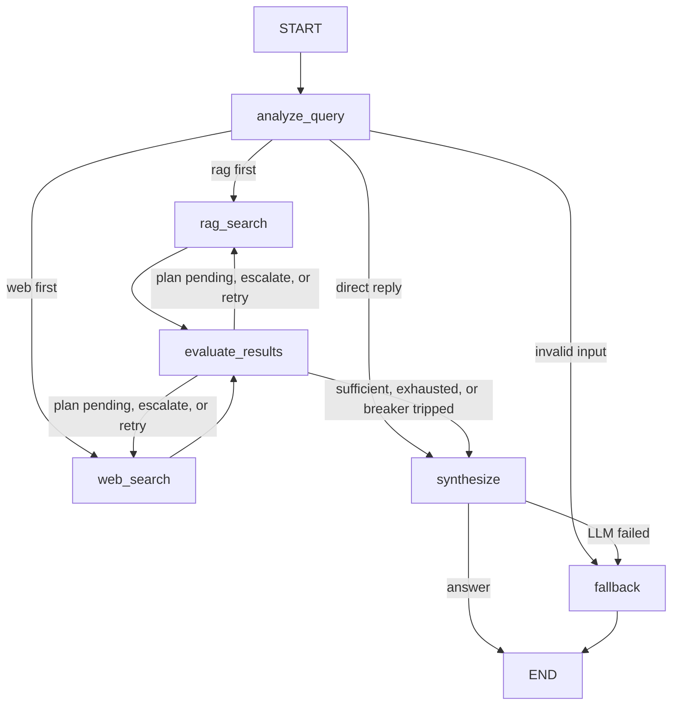

# Agentic RAG + web search orchestrator

A LangGraph agent that analyzes a query, searches internal docs (RAG), optionally searches the
web, and writes an answer with citations. Conversations are multi-turn and checkpointed to
SQLite. The RAG and web tools are mocks; the project is about orchestration. The spec is in
`project-plan.md`, the design in `implementation-plan.md`.

## Setup

```bash
python3 -m venv .venv
.venv/bin/pip install -e ".[dev]"
.venv/bin/python -m pytest
```

## Run

```bash
.venv/bin/python -m agent.cli --thread-id demo            # interactive; reuse the id to resume
.venv/bin/python -m agent.cli --thread-id demo -v         # with node-level logs
.venv/bin/python -m agent.cli -q "What is our vacation policy?" -q "and what about its limits?"
.venv/bin/python -m agent.cli --rag-fail -v -q "What is our vacation policy?"   # fallback path
```

By default the agent uses `HeuristicLLM`, a deterministic keyword-based stand-in, so no API key
is needed. To use a real model: `pip install -e ".[anthropic]"`, set `ANTHROPIC_API_KEY`, and
pass `--llm anthropic [--model <id>]`. Any LangChain chat model with structured output works
through `ChatModelLLM`.

## Graph



## How the requirements are met

| Requirement | Where |
|---|---|
| Query analysis picks tools | `nodes.py: analyze_query`, `llm.py: analyze` |
| Conditional edges | `routing.py: route_after_analysis / _evaluation / _synthesis`, wired in `graph.py` |
| Circuit breaker | `routing.py: decide_next_step`: per-turn budget `max_tool_calls`, plus a per-tool breaker after `failure_threshold` consecutive failures |
| State management | `state.py: AgentState`; `messages` persists, everything else is reset each turn |
| Checkpointing | `graph.py: open_sqlite_checkpointer` (SQLite), keyed by `thread_id` |
| Error handling | `resilience.py: call_with_retry` (timeout, backoff, transient vs permanent); nodes record errors in state and never raise; `run_turn` contains anything else |
| Citations | `nodes.py: synthesize`, `validate_citations` (markers must map to retrieved documents) |
| Mock tools | `tools.py`, with `FaultInjector` for failures and latency |

Tunables are in `config.py: AgentConfig`.
